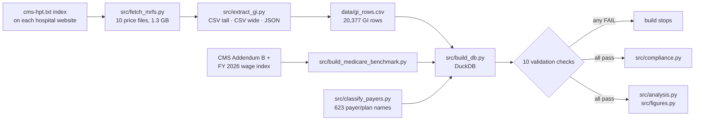

# What Westchester Hospitals Charge for a Colonoscopy

Hospitals must now publish the prices they negotiate with each insurer. I pulled the official price files for all 10 non-VA acute care hospitals in Westchester County, extracted every colonoscopy, upper endoscopy (EGD), and endoscopic ultrasound (EUS) rate, compared each one to Medicare, and checked the files against CMS's 2026 rules.

| | |
|---|---|
| **Short answer** | A commercial plan pays a hospital about **4x Medicare** for a diagnostic colonoscopy. Medicare Advantage pays about **1x**, Medicaid about **0.8x**. Within commercial, the hospital and the insurer change the price by thousands of dollars. |
| **Compliance** | All 10 files pass every CMS format rule I tested on these procedures, but **813 GI rows** are priced as a percent of total billed charges, which the files never estimate, and one hospital lists percentages like **"6300%"**. |
| **Data** | 10 price files (1.3 GB), 20,377 GI rows, 9,903 negotiated rates, 623 insurer/plan names |
| **Built with** | Python · SQL (DuckDB) · pytest · 10 automatic checks that stop the build on any error · [independent audit](#audit) |

---

## Key terms

- **Negotiated rate:** what an insurer has agreed to pay the hospital. Gross charge (the list price) is what almost nobody pays.
- **Case rate:** one price for the whole visit (room, supplies, recovery). Some hospitals also publish a price for single lines of the bill; I compare case rates to case rates.
- **Multiple of Medicare:** the negotiated rate divided by what traditional Medicare pays that hospital for the same procedure ($1,161 for a diagnostic colonoscopy). 4x = four times Medicare.

## Findings

### 1. Who pays sets the price

| Diagnostic colonoscopy | Median rate | Multiple of Medicare |
|---|---|---|
| Commercial (employer plans, whole-visit rates) | $4,724 | **4.1x** |
| Exchange (individual market, whole-visit rates) | $3,084 | 2.7x |
| NY Essential Plan | $1,602 | 1.4x |
| Medicare Advantage | $1,155 | **1.0x** |
| Medicaid managed care | $917 | **0.8x** |

Of these five, commercial pays the most and Medicaid the least for all 11 procedures studied. Commercial and Exchange plans are compared on whole-visit case rates only; the government-program segments are mostly paid by fee schedules tied to government rates, so all their rates are kept ([why](docs/methods.md#which-rows-count-as-the-price)).

<picture>
  <source media="(prefers-color-scheme: dark)" srcset="docs/figures/fig1_segments_dark.png">
  
</picture>

### 2. The hospital matters: $1,322 to $6,803 for the same procedure

The median commercial price for a diagnostic colonoscopy runs from **$1,322 at St. John's Riverside** to **$6,803 at NYP Westchester**, about 5x apart. Moving one colonoscopy from a ~$6,500 hospital to a ~$3,100 one saves more than Medicare pays for the whole procedure.

**For a patient,** this matters before the deductible is met: in-network, they pay the negotiated rate until then. Screening colonoscopies are generally free in-network under the ACA, but a diagnostic one is not, and the hospital fee alone has a median of about $1,300 at St. John's Riverside versus about $6,800 at NYP Westchester, before the doctor's and anesthesia bills.

<picture>
  <source media="(prefers-color-scheme: dark)" srcset="docs/figures/fig2_hospitals_dark.png">
  
</picture>

### 3. The insurer matters too

Comparing insurers at the same hospital for the same procedure: **UnitedHealthcare and Cigna pay above the typical insurer, Anthem and Aetna pay about the norm, and Oscar and MVP pay roughly 25% to 40% less.** These conclusions hold under three ways of counting insurers' plans; the exact order at the top (including EmblemHealth) depends on the method, so the [memo](docs/memo.md#3-insurer) shows all three.

<picture>
  <source media="(prefers-color-scheme: dark)" srcset="docs/figures/fig3_payers_dark.png">
  
</picture>

### 4. Commercial contracts often ignore complexity

Medicare pays 29% more for a colonoscopy with polyp removal than a diagnostic one. **84 of 113** commercial plans pay exactly the same for both.

### 5. The files are formatted correctly but hard to use

- **0 failures** on the 9 CMS conditional requirements I tested.
- **813 GI rows** price the visit as a percent of its total billed charges, but no file says what a visit's total charges typically are, so a patient can't estimate the dollar amount.
- Westchester Medical Center lists rates like **6300%**, very likely 63% missing a decimal point.

Details: [compliance findings](docs/compliance.md).

## Read more

| | |
|---|---|
| [Memo](docs/memo.md) (2 min) | What a managed care team would do with this, and three questions for the hospitals |
| [Compliance findings](docs/compliance.md) (5 min) | Each hospital's file, check by check |
| [Methods](docs/methods.md) | File formats, insurer mapping, case rates, the Medicare benchmark |

---

## How it works



- **Files come from each hospital's own index.** CMS requires a `cms-hpt.txt` file listing each location's price file. Reading it mattered: the first copy of one hospital's file I found through a third-party site was an outdated version dated December 2024.
- **Three formats, one table.** Tall CSV, wide CSV (hundreds of columns), and JSON (up to 630 MB, streamed) all land in one table, values copied exactly as published.
- **Medicare benchmark.** October 2026 outpatient (OPPS) rates, adjusted by each hospital's FY 2026 wage index (1.3697 for all 10).
- **Validation.** 10 checks run on every build and stop it on any failure; 17 tests re-read raw files independently and check insurer labels.

<details>
<summary><b>Hospitals and files</b></summary>

| Hospital | System | Format | File date |
|---|---|---|---|
| Westchester Medical Center | WMCHealth | CSV wide | 2026-07-28 |
| NewYork-Presbyterian Hudson Valley | NewYork-Presbyterian | JSON | 2026-03-31 |
| NewYork-Presbyterian Westchester | NewYork-Presbyterian (system file) | JSON | 2026-03-31 |
| Northern Westchester Hospital | Northwell Health | JSON | 2026-03-31 |
| Phelps Hospital | Northwell Health | JSON | 2026-03-31 |
| White Plains Hospital | Montefiore Einstein | CSV tall | 2026-09-28 |
| Montefiore Mount Vernon | Montefiore Einstein | CSV tall | 2026-09-28 |
| Montefiore New Rochelle | Montefiore Einstein | CSV tall | 2026-09-28 |
| St. John's Riverside | St. John's Riverside | CSV wide | 2026-03-27 |
| St. Joseph's Medical Center | St. Joseph's | CSV tall | 2026-07-13 |

Downloaded Oct 25, 2026. Raw files aren't committed; `src/fetch_mrfs.py` re-downloads them and records a SHA-256 of each.
</details>

## Audit

Checked two ways before publishing, both independent of the pipeline code:

1. **Full re-extraction.** A second extractor that shares no code with the pipeline ([`src/audit_reextract.py`](src/audit_reextract.py)) rebuilt all 20,377 rows from the raw files: **20,377 of 20,377 match** on all 16 compared fields.
2. **Adversarial AI review.** A separate AI agent (Claude), told to find errors, re-parsed every raw file with its own code and matched **all 5,527** negotiated prices for the 11 main procedures. It also recomputed the Medicare benchmark (exact match) and checked the published claims over three rounds.

The review caught a handful of wrong statements, 6 mislabeled insurer/plan names (fixing them moved the Medicaid colonoscopy median from $959 to $917), and one method problem: an insurer comparison that counted hospitals listing many identical plans several times. All are fixed. The insurer comparison now counts each insurer once per hospital and procedure, with [three counting methods](results/payer_index_sensitivity.csv) shown side by side.

## Reproduce it

```bash
pip install -r requirements.txt
python src/fetch_mrfs.py                # ~1.3 GB from the hospitals' websites
python src/extract_gi.py                # ~10 minutes
python src/build_medicare_benchmark.py
python src/classify_payers.py
python src/build_db.py                  # stops if any validation check fails
python src/compliance.py
python src/analysis.py
python src/figures.py
pytest
```

Hospitals update their files at least yearly, so a fresh download will give somewhat different numbers.

## Limits

- **Contract rates, not paid claims.** No volumes, denials, or actual payments.
- **Hospital fee only.** The gastroenterologist's and anesthesiologist's fees are billed separately.
- **St. Joseph's isn't in the commercial comparisons** because it publishes no commercial case rates.
- **Percent-of-charges rates are counted, not converted** to dollars, since the files don't provide total charges.

CPT codes are © American Medical Association. Labels in this repo are my own.
