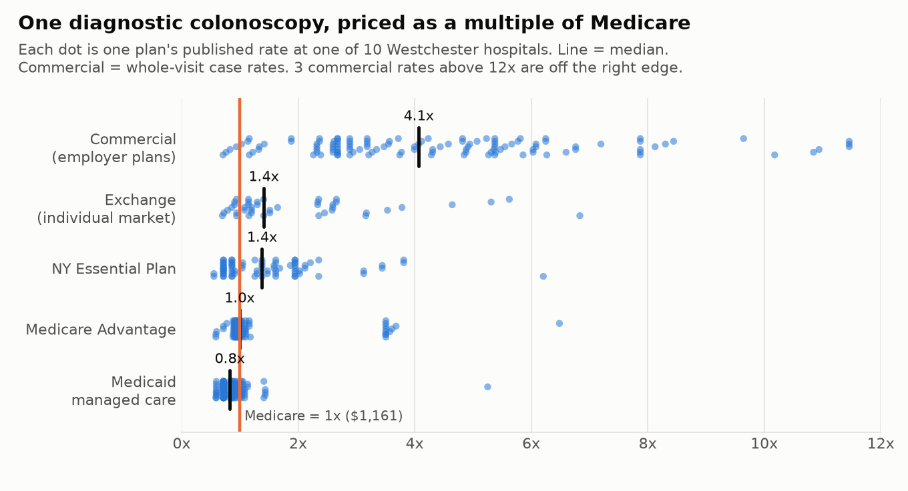
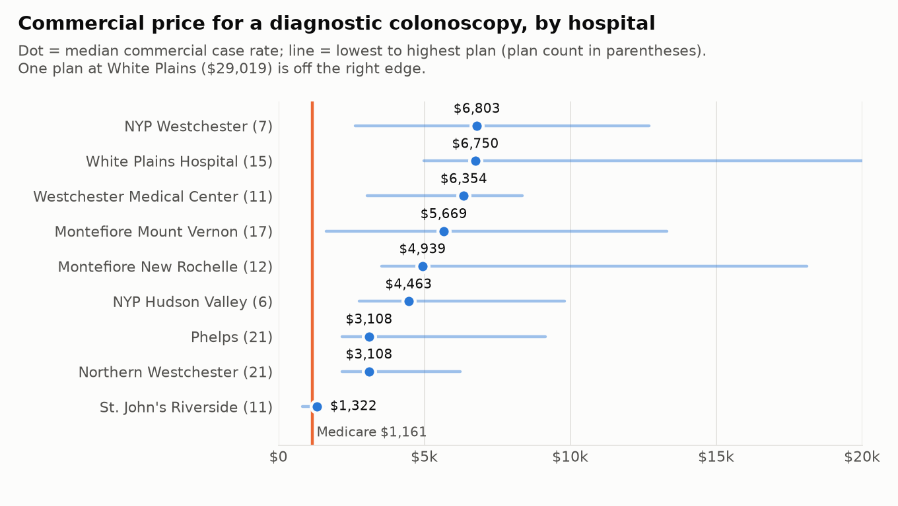
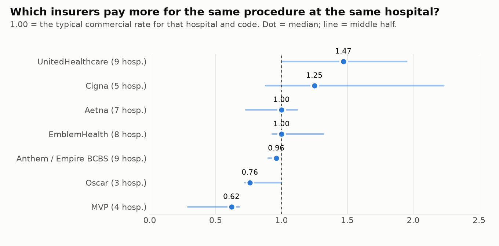
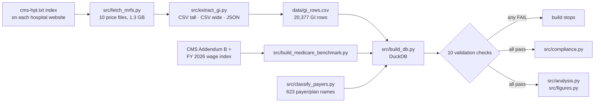

# What Westchester Hospitals Charge for a Colonoscopy

**Every hospital now has to publish the prices it negotiates with each insurer. What do those files say about GI endoscopy in Westchester County, and can a patient actually use them?**
I pulled the official price files for all 10 acute care hospitals in Westchester, extracted every colonoscopy, upper endoscopy (EGD), and endoscopic ultrasound (EUS) rate, benchmarked each one against Medicare, and checked the files against CMS's 2026 rules.

| | |
|---|---|
| **Short answer** | The same diagnostic colonoscopy pays the hospital about **4x Medicare** from a commercial plan, **1x** from Medicare Advantage, and **0.8x** from Medicaid. Which hospital and which insurer matter as much as the procedure. |
| **Compliance takeaway** | All 10 files pass every CMS v3.0 format rule I tested on these rows, but **788 published rates can't be turned into a dollar amount**, and one hospital lists percentages like "6300%". → [**Compliance findings**](docs/compliance.md) |
| **Data** | 10 hospital price files (1.3 GB; CSV tall, CSV wide, and JSON), 20,377 GI rows, 9,903 negotiated rates, 623 payer/plan names mapped to insurer and line of business |
| **Benchmark** | Medicare outpatient (OPPS) rates, Oct 2026 Addendum B, adjusted by each hospital's FY 2026 wage index |
| **Built with** | Python · SQL (DuckDB) · pytest · 10 build-stopping validation checks |
| **Status** | ✅ Complete (Oct 2026) |

<picture>
  <source media="(prefers-color-scheme: dark)" srcset="docs/figures/fig1_segments_dark.png">
  
</picture>

*Each dot is one plan's published rate for a diagnostic colonoscopy (CPT 45378) at one Westchester hospital.*

---

## Key terms (20 seconds)

- **Gross charge:** the hospital's list price (chargemaster). Almost nobody pays it.
- **Negotiated rate:** what an insurer has agreed to pay the hospital. This is the number that matters for anyone with insurance.
- **Case rate vs. fee schedule:** a case rate is one price for the whole visit (room, supplies, recovery). A fee-schedule rate prices one line of the bill. Several hospitals publish both for the same plan, so I compare case rates to case rates (see [methods](docs/methods.md)).
- **Multiple of Medicare:** the negotiated rate divided by what traditional Medicare pays that hospital for the same code. 4x means four times Medicare.

## Five findings

| # | Finding | The number | Details |
|---|---|---|---|
| 1 | **The payer's line of business sets the price more than anything else.** | Diagnostic colonoscopy: commercial **4.1x** Medicare (median $4,724), Medicare Advantage **1.0x**, Medicaid managed care **0.8x** | [Memo](docs/memo.md#1-line-of-business) |
| 2 | **Hospital choice is worth thousands of dollars to a commercial plan.** | Median commercial case rate for the same procedure: **$1,322** at St. John's Riverside to **$6,803** at NYP Westchester (5.1x apart) | [Memo](docs/memo.md#2-hospital) |
| 3 | **UnitedHealthcare pays the most, MVP the least, for the same procedure at the same hospital.** | UnitedHealthcare **47% above** the typical commercial rate; Cigna +25%; Aetna, Emblem, Anthem at about the norm; MVP **38% below** | [Memo](docs/memo.md#3-insurer) |
| 4 | **Commercial case rates ignore complexity; Medicare doesn't.** | **84 of 113** commercial plans pay the same price for a diagnostic colonoscopy and a polyp removal. Medicare pays 29% more for the polyp removal. | [Memo](docs/memo.md#4-flat-case-rates) |
| 5 | **The files are formatted correctly but often unusable.** | 0 failures on 9 CMS conditional requirements; **788** percent-of-charges rates with no gross charge to apply them to; **134** percentages over 1,000% | [Compliance](docs/compliance.md) |

<picture>
  <source media="(prefers-color-scheme: dark)" srcset="docs/figures/fig2_hospitals_dark.png">
  
</picture>

<picture>
  <source media="(prefers-color-scheme: dark)" srcset="docs/figures/fig3_payers_dark.png">
  
</picture>

## Where to go next

| You have... | Read |
|---|---|
| **2 minutes** | [The memo](docs/memo.md): what a managed care team would do with this |
| **5 minutes** | [Compliance findings](docs/compliance.md): what each hospital's file gets right and wrong |
| **An interest in the method** | [Methods and data notes](docs/methods.md): file formats, payer mapping, case rates, the Medicare benchmark |
| **A laptop** | [Reproduce it](#reproduce-it) |

---

## How the pipeline works



**Finding the files the way CMS intends.** Every hospital must post a `cms-hpt.txt` file at the root of its website listing each location's price file. The fetch step reads that index instead of hard-coding URLs, which matters: the first copy of one hospital's file I found through a third-party site was a year-old version at an outdated address. The index pointed to the current one.

**Three formats, one table.** CMS allows a "tall" CSV (one row per payer), a "wide" CSV (one column group per payer, hundreds of columns), and JSON (600+ MB for two Northwell hospitals, streamed rather than loaded). All three land in the same 26-column table with values copied exactly as published.

**Validation.** Every build runs 10 checks ([`sql/02_validation.sql`](sql/02_validation.sql)): all hospitals present, no rows lost in joins, every payer classified, the Medicare benchmark recomputed from Addendum B, uniqueness, and parse checks. The tests ([`tests/test_pipeline.py`](tests/test_pipeline.py)) re-read one raw file of each format with a separate code path and confirm the database matches.

<details>
<summary><b>Hospitals and files</b> (click to expand)</summary>

| Hospital | System | Format | File date |
|---|---|---|---|
| Westchester Medical Center | WMCHealth | CSV wide | 2026-07-28 |
| NewYork-Presbyterian Hudson Valley | NewYork-Presbyterian | JSON | 2026-03-31 |
| NewYork-Presbyterian Westchester | NewYork-Presbyterian (system file) | JSON | 2026-03-31 |
| Northern Westchester Hospital | Northwell Health | JSON | 2026-03-31 |
| Phelps Hospital | Northwell Health | JSON | 2026-03-31 |
| White Plains Hospital | Montefiore Einstein | CSV tall | 2026-09-28 |
| Montefiore Mount Vernon | Montefiore Einstein | CSV tall | 2026-09-28 |
| Montefiore New Rochelle | Montefiore Einstein | CSV tall | 2026-09-28 |
| St. John's Riverside | St. John's Riverside | CSV tall | 2026-03-27 |
| St. Joseph's Medical Center | St. Joseph's | CSV tall | 2026-07-13 |

Files downloaded Oct 25, 2026. Raw files are not committed (1.3 GB); `src/fetch_mrfs.py` re-downloads them and records a SHA-256 of each in `data/raw/manifest.csv`.
</details>

## Reproduce it

```bash
pip install -r requirements.txt
python src/fetch_mrfs.py                # ~1.3 GB from the hospitals' own websites
python src/extract_gi.py                # ~10 minutes; the JSON files are streamed
python src/build_medicare_benchmark.py
python src/classify_payers.py
python src/build_db.py                  # stops if any validation check fails
python src/compliance.py
python src/analysis.py
python src/figures.py
pytest
```

Hospitals update their files at least once a year, so a fresh download will produce somewhat different numbers.

## Limits

- **Published rates are not paid claims.** A negotiated rate is what the contract says; it doesn't show how often a procedure happens or what was actually paid after denials.
- **Facility fee only.** The physician (professional) fee for the gastroenterologist and anesthesia are billed separately and are not included.
- **Case rates are compared to case rates**, which drops St. Joseph's from the commercial comparison (it publishes only fee-schedule lines for commercial plans).
- **Percentage and algorithm rates are counted, not converted.** Turning "63% of billed charges" into dollars would require an estimate of total charges for the visit, which the files don't provide.

CPT codes are © American Medical Association. Descriptions in this repo are my own plain-English labels.
